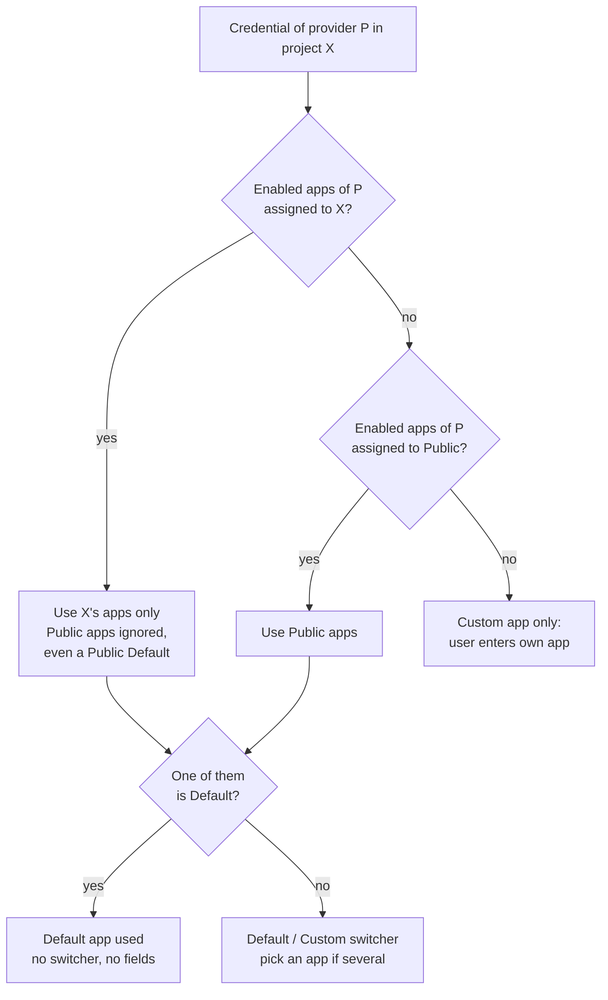
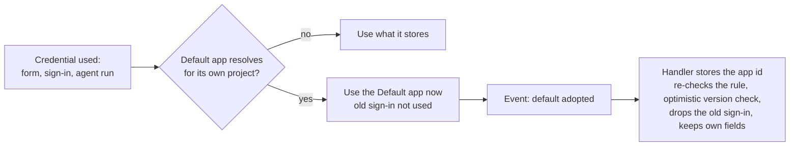

# OAuth Apps — feature specification (#7149)

Issue: https://github.com/EliteaAI/elitea_issues/issues/7149 · parent #6823 · depends on #7148
Version: 2026-10-27 · Status: base feature, tier precedence and the PR review changes are in the open PRs;
the remaining rules are listed in section 11. R8 is built as option B (section 12).

---

## TL;DR

**Problem.** Every Teams, Outlook or SharePoint credential needs a Microsoft Entra ID app registration:
client ID, client secret, discovery endpoint and scopes. Ordinary users rarely have one, and secrets get
copied into many credentials.

**Solution.** Admins register **OAuth apps** once in the Admin Portal and assign each app to **Public**
(every project) or to selected **team projects**. Users then create credentials without any app details:
the platform picks the app, keeps its secret server-side and applies the admin's scopes.

**How a credential gets its app** (for the credential's own project):

**Key rules**

| | Rule |
|---|---|
| Scope | An app is for **Public** or for **team projects**, never both. Projects is required. |
| Team project wins Public | If a team project has any enabled app, Public apps are ignored there, even when a Public app is Default and the project's apps are not. |
| Default | At most one Default app per provider per scope. A Default app means no choice for users. |
| Follows the admin | Credentials are resolved on **every use**; admin changes (add, disable, delete, new default) apply on next use, no data migration. |
| Default always wins | Once a Default app resolves for the credential's project, every credential uses it on next use (explicit picks and the user's own Custom app included) and **stores it**: it stays on that app even if the Default goes away. SharePoint App-only is never replaced. Users sign in once again (section 12). |
| Sign-in | A sign-in belongs to one app; when the app changes, the user signs in once again. |
| Server decides | The server returns the apps that apply, already filtered: only the Default app if there is one, else only the non-default apps. The form only counts them. |
| Existing credentials | No migration. Credentials created before the feature keep their own app and open as Custom app until a Default app applies to them (R8). |
| Security | The app secret never leaves the server and is sent only to the app's own token endpoint. Sign-in names the credential type, and the server checks the app serves it in that project. All rules are enforced by the server, not only the UI. |

**Status.** Built: Admin Portal section, write-only secret, Default/Custom form, server-side secret
resolution, admin Test connection, team-project-wins-Public precedence, server-filtered app list and the
credential-type check on sign-in, R8 as option B (a Default app wins and is stored) and sign-ins tied to their
client (R7); section 12. Still to do: per-scope defaults and stricter save checks (S1).

---

## 1. Goals and non-goals

**Goals**
- Users create Teams, Outlook and SharePoint credentials without knowing app registration details.
- Admins control which app, scopes and sign-in settings apply, per environment and per team project.
- The client secret is stored once, rotated centrally and never exposed.
- Admin changes reach every credential without migrations or user action (except a new sign-in when the app changes).

**Non-goals (separate decisions)**
- Feature toggle "default app only" platform-wide (postponed; the original plan used the old `entra_*` names and was not kept).
- Project admins managing their own project's apps (only platform admins).
- Providers other than Microsoft Entra ID (the model is ready for them; none added).
- Personal-project apps.

## 2. Concepts

| Term | Meaning |
|---|---|
| **OAuth app** (AS) | Admin-managed app settings: provider, name, client ID, client secret, discovery endpoint, scopes per credential type, auto refresh, Enabled, Default, Projects. |
| **Provider** | Identity provider of an app. Today only **Microsoft Entra ID**, serving Teams, Outlook and SharePoint credentials. |
| **Public** | The platform public project (`ai_project_id`, `get_public_project_id()`). An app assigned to Public applies to every project, the same way public shared credentials and default models do. |
| **Team project** | Any non-personal project other than Public. |
| **Scope / tier** | The projects an app serves: Public, or a set of team projects. |
| **Default app** | The app of a scope that users get without choosing. |
| **Default app mode** | A credential that uses an OAuth app. Stores only a reference. |
| **Custom app mode** | A credential with the user's own client ID, secret, endpoint and scopes (today's behaviour). |
| **Credential's own project** | The project where the credential is saved (team project, Public, or the user's personal project). |

## 3. Admin Portal — Configuration → OAuth Apps

Placed after MCP Servers. Visible to platform admins (`configuration.oauth_apps.view` / `.edit`).

### 3.1 App dialog

**General** (behaviour):

| Field | Rules |
|---|---|
| Provider | Only **Microsoft Entra ID** today: the single option, preselected, and the field is disabled. It decides which credential types, scope lists and discovery hosts the dialog shows. |
| Name | Required, ≤ 128 chars. Shown to users when they pick an app. |
| Enabled | On by default. Off = the app applies nowhere; reversible. |
| Default app | "Users get this app and cannot choose a custom one." See 3.3. |
| Projects | **Required on every level, nothing preselected, no "all projects" shortcut.** The admin always picks projects explicitly: the **public project** (its apps apply in every project, like public shared credentials and default models) or team projects (searchable). Personal projects are not offered. Public **or** team projects, never both. An empty list is rejected by the dialog (Save disabled, "Required. The app applies only in the selected projects.") and by the server on create, update and Test connection ("Select at least one project"); unknown project ids are rejected ("Unknown project: <id>"). An app without projects (never valid on save) applies nowhere. |

**App settings**:

| Field | Rules |
|---|---|
| Client ID | Required. |
| Client secret | Required on create. **Write-only**: shown as `•••• (set)` with **Replace**; never returned. |
| OAuth discovery endpoint | Provider hosts only (Entra: `https://login.microsoftonline.com/<tenant or organizations>`). Empty = provider default. |
| Credential types | One on/off switch per credential type of the provider (Entra: **Teams, Outlook, SharePoint**), all on by default; at least one must stay on. A type switched **off** makes this app unavailable to that type's credentials: it is not offered, not resolved, and existing credentials of that type that use it show "<name> is no longer offered for <Type> credentials by your administrator. Switch to Custom app." The type's scopes are kept, so switching it on again restores them. |
| Scopes | Per credential type that is on: checkboxes for Teams and Outlook (recommended set preselected), free text for SharePoint. Empty = the type's recommended set. |
| Auto refresh token | Keeps users signed in with offline_access. |

**Test connection**: checks client ID, secret and tenant with the provider (Entra: client-credentials request
to the app's own token endpoint). Reports wrong or expired secret, unknown client ID, unknown tenant; a tenant
policy that blocks app-only tokens is a warning. Uses unsaved form values; an empty secret uses the stored one.

### 3.2 List

Columns: Name, Provider, Client ID, Credentials (chips of the types switched on), Projects ("N selected" /
"None"), Status (Enabled, Default). Actions: edit, delete.

**Edit dialog:** Save is enabled only after a change (or Replace secret); reverting the change disables it again.
Test connection works without changes.

### 3.3 Admin validation (server-side, on every write)

| # | Rule | Message |
|---|---|---|
| A1 | Projects is not empty and every id exists (create, update, Test connection) | "Select at least one project" / "Unknown project: <id>" |
| A3 | Public is not combined with team projects | "An app is either for all projects (Public) or for selected team projects, not both" |
| A4 | At most **one enabled Default app per provider per scope**: one for Public, one per team project (checked on create, edit, enable, Default on, project change; inside a transaction) | "pr_1 already has a default app: <name>" |
| — | Discovery endpoint on the provider's hosts; scopes only for the provider's credential types; provider unchanged on edit | field-specific |

### 3.4 Disable and delete

- **Delete** confirmation: "N credentials use this app. After deletion they will use <next app> / will need
  another app or their own app." Delete is allowed.
- **Disable** is the reversible alternative, with the same impact text plus "can be re-enabled".
- Neither rewrites credentials; credentials re-resolve on next use (section 5).

## 4. Credential form — Teams, Outlook, SharePoint

### 4.1 Resolution rule

For a credential of provider **P** whose own project is **X**:

Only apps that are **enabled** and have the credential's **type switched on** count.

1. **Project tier**: such apps of P assigned to X (empty when X is Public or a personal project).
2. **Public tier**: such apps of P assigned to Public.
3. **Active tier** = project tier if it has any app, else Public tier. A project tier with any app hides all Public apps in X.
4. Active tier empty → **Custom app only**.
5. Active tier has a Default app → **Default app, no switcher**.
6. Otherwise → **Default / Custom switcher**; one app is preselected, several → the user picks one.

**The server does the filtering.** The app list a project member gets holds only the active tier, and of that
tier **only the Default app(s) when there is one, otherwise only the non-default apps**; Default and
non-default apps are never mixed. The form makes no decisions of its own beyond two checks:

| Apps returned | Form |
|---|---|
| none | Custom app only, no switcher |
| one, Default | No switcher: "Sign-in settings are managed by your administrator." |
| one, not Default | Switcher; the app is used without a picker |
| more than one | Switcher plus an app picker |

### 4.2 What the user sees

| # | Situation for project X | Form |
|---|---|---|
| 1 | No app for X and none for Public | No switcher; Custom app fields |
| 2 | Only Public apps, no Default | Switcher; Default tab uses the Public app (pick if several) |
| 3 | Only Public apps, one Default | No switcher; "Sign-in settings are managed by your administrator." |
| 4 | Only X apps | As 2 / 3 with X's apps |
| 5 | Public apps and X apps | X's apps win; then as 2 / 3 |
| 6 | Several X apps | The Default wins; without one, the user picks from X's apps |

Personal projects have no project tier, so their credentials always use the Public tier.

### 4.3 Form details

- **Default app tab**: no client, secret, endpoint, scope or refresh fields; Save needs only a name (and an app
  when several apply without a Default).
- **Custom app tab**: client ID, secret, endpoint, scopes, auto refresh (unchanged from before the feature).
- **Shared** is not offered for these three credential types.
- **Configuration OAuth** sign-in window: Scope is read-only for Default app credentials (shows the admin's scopes).
- An app that no longer applies shows on the credential: "<name> was disabled by your administrator. Switch to
  Custom app." (or "…removed…", "…not available in this project…").
- SharePoint keeps its **App-only** option. Custom app and App-only share the client ID and secret: switching
  between them keeps those values and both treat them as required.
- The auth section never stays empty: without a known project it shows the Custom app fields, and while the
  app list reloads in the background the current form stays as it is.

### 4.4 Credentials created before the feature

No migration is needed. The feature only adds an optional app reference; the existing fields keep their names
and meaning, and nothing is rewritten on deploy or on open.

| | Behaviour |
|---|---|
| Form | Opens on **Custom app** (it has its own client ID) while no Default app applies; with one, it opens as a Default app credential (R8). SharePoint "Delegated" opens as Custom app, "App-only" as App-only (never replaced). |
| Use | Agent runs, test connection and sign-in use the credential's own app, as before. |
| Sign-ins | Kept: token keys are per credential and endpoint, unchanged. |
| Save | Not dirty on open; saving keeps the own app. |
| Shared | The flag is no longer offered on these types; an existing shared credential stays shared until edited by a data fix. |

When a Default app applies, such credentials move to it on next use (R8, section 12).

## 5. Credential lifecycle

| # | Rule |
|---|---|
| R1 | A Default app credential stores **"default"** (whatever the admin designates) or an **explicit app id** (picked from a list). It never stores client ID, secret, endpoint, scopes or refresh settings. A Custom credential stores the user's own app. |
| R2 | **Resolve on use.** Opening the credential, test connection, sign-in, token refresh and every agent run apply section 4.1 with the current admin settings. No background job rewrites credentials. |
| R3 | **"default" follows the admin**: a new project app, a new Default, a disabled or deleted app — the credential uses the newly resolved app on next use. |
| R4 | An **explicit pick** is used only while **no Default app resolves** for the credential's project, and the picked app stays enabled and assigned to that project. As soon as a Default resolves (R8), the credential switches to it; if the Default later goes away, the pick applies again. |
| R5 | An explicit app that is deleted, disabled or no longer assigned → the credential shows the reason and "pick another app or switch to Custom app"; agent runs fail with the same message. Nothing is removed from the credential; re-enabling the app restores it. |
| R6 | Resolution uses the **credential's own project**, never the project an agent runs in. A personal credential used by an agent in pr_1 resolves through Public. |
| R8 | **A resolved Default always wins, and is stored (option B).** Whenever section 4.1 resolves a Default app for the credential's own project, every Teams, Outlook and SharePoint credential there uses it on next use (form, test connection, sign-in, agent run), whatever it stored: an explicit pick or the user's own Custom app. The credential is then **switched to that app permanently**: it stores the app reference, as if the user had picked it. If the Default goes away later, it stays on that app (or shows "… Switch to Custom app." when the app is gone). The user's own client fields stay in the database, unused, and come back when the user switches to Custom app. **SharePoint App-only is never replaced.** New Custom credentials can't be created while a Default applies. |

## 6. Sign-in and tokens

| # | Rule |
|---|---|
| R7 | A stored sign-in (refresh token, browser token) is bound to the app it was made with (app id + client ID). When the resolved app or its client ID / endpoint changes, the old sign-in is ignored and the user signs in once again. A token is never sent with another app's client. |
| T1 | Token cache keys stay per credential (`<credential uuid>:<endpoint>`) plus the app binding of R7. |
| T2 | Rotating an app's secret needs no new sign-in (same client ID). |

## 7. Security and server enforcement

| # | Rule |
|---|---|
| S1 | Credential create / update is rejected when: Custom app is chosen where a Default applies; an explicit app is outside the credential's project, disabled or of another provider; several apps apply, none is Default and none is picked. |
| S2 | Test connection, OAuth sign-in proxy, token refresh, stored-login refresh and agent runs resolve on the server; for Default app credentials the browser's client ID, scopes and endpoint are ignored. The app reference and credential type in a sign-in or refresh come from the browser, so the server requires the type and applies the full availability check (enabled, type switched on, project covered, tier precedence) before it uses the app's secret. |
| S3 | The app secret lives in the public project's hidden vault, is never returned by any API (`client_secret_set` only), and is sent only to the app's own token endpoint. |
| S4 | Admin writes re-validate A1, A3, A4; only platform (Administration) admins may write. |
| S5 | Save-time checks use current admin settings, not what the form showed. |
| S6 | API and MCP calls get the same checks; the UI only mirrors them. |
| S7 | Generic configuration APIs cannot list, read, create, edit, delete or resolve OAuth app records. |

## 8. Edge cases

| Event | Behaviour |
|---|---|
| Default app appears in a scope | All credentials of that provider there use it on next use; one new sign-in each. |
| That Default app is later removed | Credentials return to what they stored (explicit app, "default" re-resolution, or own Custom app). |
| A project app is added for pr_1 | pr_1 now uses only its own apps (Public apps ignored, even a Public Default). If it is Default: every pr_1 credential uses it. If not: "default" credentials move to it, explicit Public picks show R5 (no longer in scope), Custom ones stay Custom. |
| A picked app becomes Default (or another app becomes Default) | Credentials with an explicit pick switch to the Default on next use (R4, R8). |
| App's projects changed so X isn't covered | Same as disabled for credentials in X. |
| A credential type switched off on an app | For that type only, the app is treated as disabled (it no longer counts in its tier); other types are unaffected. |
| App's client ID or endpoint changed | Credentials using it need one new sign-in. |
| Project deleted | Its id is dropped from app project lists; an app left without projects applies nowhere ("None" in the list) until the admin assigns projects. |
| Request without a project | No app resolves: availability is always checked against the credential's project; a missing project never means "everywhere". |
| Two admins save conflicting Defaults | Second save rejected (A4, transactional check). |
| Credential saved in Public | Only the Public tier applies. |
| Admin changes apps while a user's form is open | Save is re-checked on the server (S5); the user sees the error and the form refreshes. |
| App list still loading in the form | Auth fields are hidden until the mode is known. |

## 9. Data and interfaces

| Item | Value |
|---|---|
| App record | `configuration` row, `type='oauth_app'`, `shared=false`, in the public project. `data`: `provider`, `client_id`, `client_secret` (vault reference), `oauth_discovery_endpoint`, `scopes{type:[...]}`, `auto_refresh_token`, `is_default`, `enabled`, `allowed_project_ids` (Public id or team ids), `credential_types` (types switched on; unset = all). |
| Credential (Default app mode) | `data.oauth_app_id` = `"default"` or an app uuid. |
| Admin API | `GET/POST /api/v2/admin/oauth_apps/administration`, `PUT/DELETE …/{app_id}`, `POST /api/v2/admin/oauth_app_check/administration[/{app_id}]`. Delete/disable impact count: to add. |
| User API | `GET /api/v2/configurations/oauth_apps/{project_id}?type=` → apps of the active tier (no secrets): only its Default app(s) when it has one, else only its non-default apps; and `mode` (`default` / `choice` / `custom`). |
| OAuth proxy | `POST /api/v2/elitea_core/mcp_oauth_proxy/{project_id}` accepts `oauth_app_id` instead of a secret, together with the required `credential_type`. |
| Permissions | `configuration.oauth_apps.view`, `configuration.oauth_apps.edit` (admin, super_admin), seeded on startup. |
| Seed | Elitea default multi-tenant app (#7148) from `oauth_default_app` config, Projects = Public; can be disabled, not deleted. |

## 10. Acceptance criteria

1. Each case of 4.2 on the create form, for a credential in Public, a team project and a personal project.
2. Adding a pr_1 app moves existing "default" credentials in pr_1 to it on next use and asks for one sign-in; explicit picks follow R4/R5.
3. Deleting a Default app: the dialog shows the count; credentials resolve to the next app or show the R5 message.
4. A personal credential used by an agent in pr_1 uses the Public app.
5. Admin save is rejected for: no projects, Public + team projects, a second Default in a project.
6. API calls that bypass the form are rejected for every S1 case.
7. Re-enabling a disabled app restores credentials without user action.
8. A Custom credential in pr_1 uses a newly added pr_1 Default app on next use (one sign-in) and returns to its own app when that Default is deleted.
9. The secret never appears in any response; the proxy refuses a token endpoint that isn't the app's.

## 11. Implementation status

| Area | Built (local, uncommitted) | To do for this spec |
|---|---|---|
| Provider select (Entra only, disabled), per-type on/off switches | Done (2026-10-26) |
| Admin section, dialog, write-only secret, Test connection | Done; Projects required in the dialog and on the server, Save enabled only after a change (2026-10-27) | Personal projects hidden; "Public" label for the public project; Scope column |
| Admin validation | Provider, endpoint, scopes | A1, A3, per-scope Default (A4; today one Default per provider platform-wide, newest wins) |
| Delete / disable | Delete with generic confirm | Impact count and next-app text; disable alternative |
| Resolution | Per-app project list, required; public project = every project; empty list rejected on save and resolves nowhere; **tier precedence (4.1): a team project's own apps replace Public apps per credential type**; app list filtered by the server (Default only, else non-defaults only) (2026-10-27) | — |
| Credential storage | App uuid stored | `"default"` vs explicit pick (R1, R3, R4) |
| Project used | Credential's project in the form, agent's project at runtime | Credential's own project everywhere (R6) |
| Default vs Custom | R8 option B: a resolved Default app wins and is stored on next use; App-only excluded; sign-ins tied to their client (2026-10-28) | Admin impact count before Default is turned on |
| Sign-in | Per credential + endpoint; bound to the client it was made with (R7, 2026-10-28) | — |
| Server enforcement | App validity on save; secret pinned to the app's endpoint; sign-in and refresh require the credential type and re-check availability (2026-10-27) | S1 (Custom where Default applies, missing pick), S2 for scopes |
| Credential form | 3 modes, scope lock in sign-in window, no Shared | Explicit pick list when several apps, error texts for R5 |
| Edge cases | — | Project deletion clean-up, transactional Default check |

Detailed history of what was built: [implementation_summary.md](implementation_summary.md).

## 12. R8 — decisions and design (option B)

**Decisions (2026-10-28)**

| # | Decision |
|---|---|
| 1 | When a Default app takes over a credential, its users **sign in again** once. |
| 2 | **SharePoint App-only** is excluded: it always keeps its own app. |
| 3 | The credential's **own client fields are kept** in the database, unused while it points at an app. |
| 4 | A sign-in is **tied to the app (client) it was made with** (R7). |
| 5 | **Option B**: the Default app is **stored** on the credential, which stays on it after the Default goes away. |

**How it works**

- **Reads never write.** Agent runs, sign-ins and form reads resolve the Default app in memory and only emit
  an event. A separate handler stores it, outside that request.
- The handler is **idempotent and safe**: it re-checks the rule against the stored row, writes only when the
  stored app differs, uses the credential's version (a concurrent user edit wins and the next use adopts
  again), never fails the run, and logs each switch.
- **Sign-ins**: a stored login records the client it belongs to; one made with another client is not used,
  and browser tokens are used only for the client they were issued to. The user is asked to sign in.
- **No migration and no bulk job**: credentials switch one by one on their next use.

**Known effects**

| Effect | Note |
|---|---|
| The seeded Elitea default app is Default and Public | Where it is configured, every existing Teams, Outlook and SharePoint credential (except App-only) in every project switches to it on next use; users sign in once. Accepted (decision 1). |
| Scopes and tenant come from the Default app | Tools that relied on scopes or a tenant of the user's own app may need the admin to adjust the app. |
| Switch is permanent | Turning Default off later doesn't return credentials to their own app; users switch to Custom app themselves (option B). |
